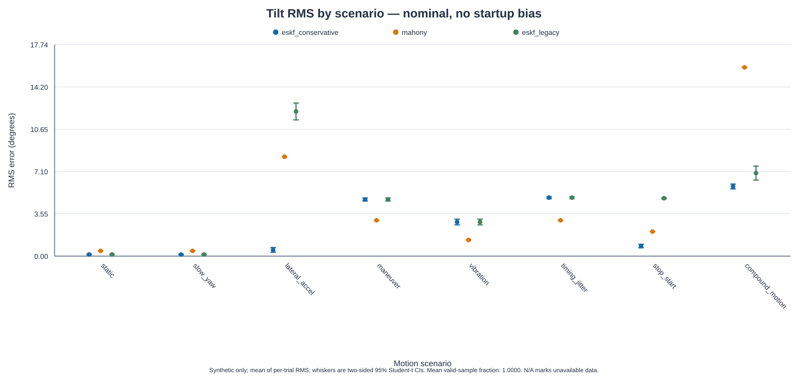
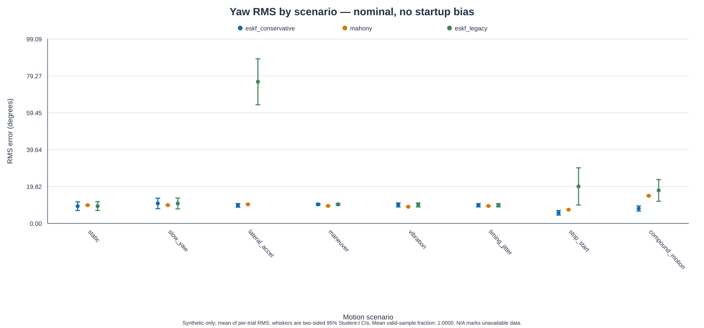
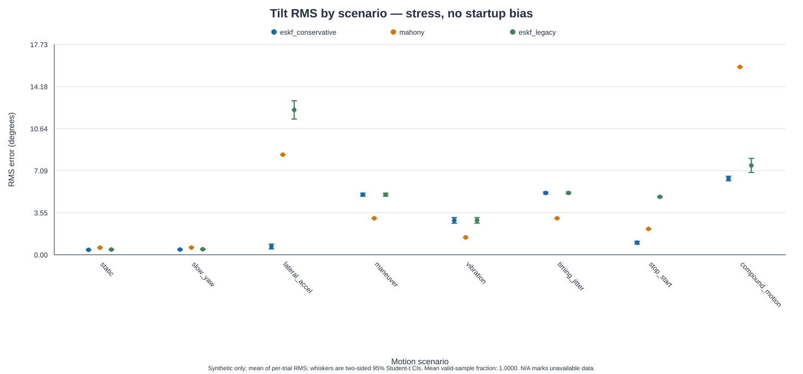
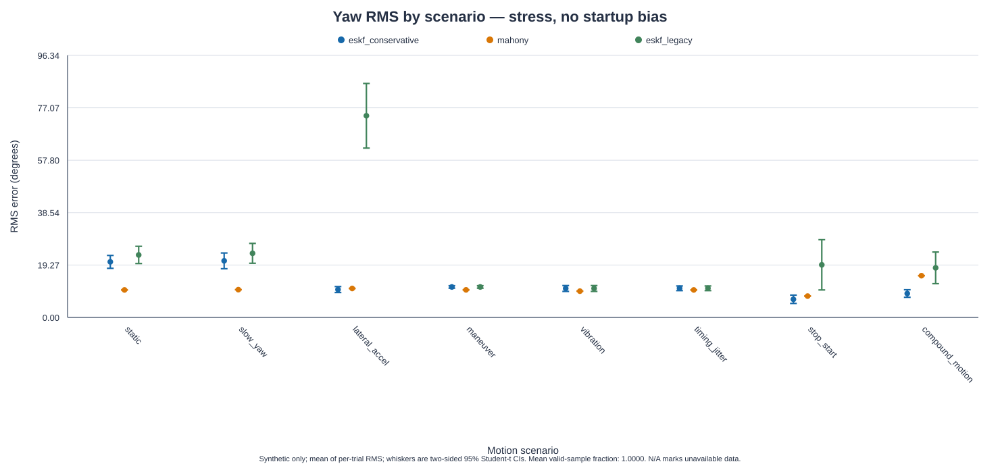

# Bundle B: synthetic estimator comparison

Source CSV: `bundle_b_no_startup_bias.csv`. Schema v2; metric definition v2; truth integration v2.
These are host-side synthetic results, not measured RP2350 or LSM6DS3 performance.

The checked-in eight-trial intervals are preliminary descriptive uncertainty under the stated simulator assumptions; they are not real-world accuracy bounds.

Each cell summarizes the arithmetic mean of per-trial RMS values with a two-sided 95% Student-t confidence interval and sample SD across trials. Missing values remain explicit.

## Per-trial RMS summary

| Scenario | Profile | Startup bias | Estimator | Trials | Tilt RMS mean [95% CI], deg | Tilt SD, deg | Yaw RMS mean [95% CI], deg | Yaw SD, deg | Valid fraction | Invalid samples |
|---|---|---:|---|---:|---:|---:|---:|---:|---:|---:|
| compound_motion | nominal | false | eskf_conservative | 8 | 5.845 [5.644, 6.046] (n=8) | 0.241 | 8.021 [6.645, 9.397] (n=8) | 1.646 | 1.0000 | 0 |
| compound_motion | nominal | false | eskf_legacy | 8 | 6.968 [6.380, 7.555] (n=8) | 0.703 | 17.738 [11.912, 23.564] (n=8) | 6.969 | 1.0000 | 0 |
| compound_motion | nominal | false | mahony | 8 | 15.841 [15.838, 15.843] (n=8) | 0.003 | 14.841 [14.804, 14.878] (n=8) | 0.044 | 1.0000 | 0 |
| compound_motion | stress | false | eskf_conservative | 8 | 6.429 [6.243, 6.615] (n=8) | 0.222 | 8.784 [7.390, 10.178] (n=8) | 1.667 | 1.0000 | 0 |
| compound_motion | stress | false | eskf_legacy | 8 | 7.532 [6.942, 8.123] (n=8) | 0.706 | 18.216 [12.405, 24.026] (n=8) | 6.950 | 1.0000 | 0 |
| compound_motion | stress | false | mahony | 8 | 15.828 [15.826, 15.831] (n=8) | 0.003 | 15.348 [15.311, 15.386] (n=8) | 0.045 | 1.0000 | 0 |
| lateral_accel | nominal | false | eskf_conservative | 8 | 0.522 [0.327, 0.717] (n=8) | 0.233 | 9.700 [8.735, 10.664] (n=8) | 1.153 | 1.0000 | 0 |
| lateral_accel | nominal | false | eskf_legacy | 8 | 12.138 [11.430, 12.846] (n=8) | 0.847 | 76.110 [63.748, 88.473] (n=8) | 14.787 | 1.0000 | 0 |
| lateral_accel | nominal | false | mahony | 8 | 8.339 [8.336, 8.342] (n=8) | 0.003 | 10.247 [10.193, 10.300] (n=8) | 0.064 | 1.0000 | 0 |
| lateral_accel | stress | false | eskf_conservative | 8 | 0.692 [0.492, 0.892] (n=8) | 0.240 | 10.259 [9.170, 11.349] (n=8) | 1.303 | 1.0000 | 0 |
| lateral_accel | stress | false | eskf_legacy | 8 | 12.214 [11.445, 12.982] (n=8) | 0.919 | 74.130 [62.243, 86.017] (n=8) | 14.218 | 1.0000 | 0 |
| lateral_accel | stress | false | mahony | 8 | 8.439 [8.437, 8.442] (n=8) | 0.003 | 10.648 [10.595, 10.702] (n=8) | 0.064 | 1.0000 | 0 |
| maneuver | nominal | false | eskf_conservative | 8 | 4.751 [4.624, 4.878] (n=8) | 0.152 | 10.242 [9.763, 10.722] (n=8) | 0.573 | 1.0000 | 0 |
| maneuver | nominal | false | eskf_legacy | 8 | 4.751 [4.624, 4.878] (n=8) | 0.152 | 10.242 [9.763, 10.722] (n=8) | 0.573 | 1.0000 | 0 |
| maneuver | nominal | false | mahony | 8 | 3.006 [3.002, 3.009] (n=8) | 0.004 | 9.405 [9.356, 9.453] (n=8) | 0.058 | 1.0000 | 0 |
| maneuver | stress | false | eskf_conservative | 8 | 5.065 [4.941, 5.189] (n=8) | 0.148 | 11.206 [10.752, 11.660] (n=8) | 0.543 | 1.0000 | 0 |
| maneuver | stress | false | eskf_legacy | 8 | 5.065 [4.941, 5.189] (n=8) | 0.148 | 11.206 [10.752, 11.660] (n=8) | 0.543 | 1.0000 | 0 |
| maneuver | stress | false | mahony | 8 | 3.073 [3.069, 3.077] (n=8) | 0.004 | 10.138 [10.089, 10.187] (n=8) | 0.059 | 1.0000 | 0 |
| slow_yaw | nominal | false | eskf_conservative | 8 | 0.134 [0.114, 0.154] (n=8) | 0.024 | 10.744 [7.918, 13.569] (n=8) | 3.380 | 1.0000 | 0 |
| slow_yaw | nominal | false | eskf_legacy | 8 | 0.137 [0.117, 0.158] (n=8) | 0.024 | 10.725 [7.807, 13.643] (n=8) | 3.490 | 1.0000 | 0 |
| slow_yaw | nominal | false | mahony | 8 | 0.440 [0.434, 0.445] (n=8) | 0.006 | 9.824 [9.776, 9.871] (n=8) | 0.057 | 1.0000 | 0 |
| slow_yaw | stress | false | eskf_conservative | 8 | 0.438 [0.411, 0.464] (n=8) | 0.031 | 20.797 [17.912, 23.683] (n=8) | 3.452 | 1.0000 | 0 |
| slow_yaw | stress | false | eskf_legacy | 8 | 0.465 [0.431, 0.499] (n=8) | 0.041 | 23.566 [19.909, 27.224] (n=8) | 4.375 | 1.0000 | 0 |
| slow_yaw | stress | false | mahony | 8 | 0.603 [0.598, 0.607] (n=8) | 0.006 | 10.201 [10.154, 10.248] (n=8) | 0.057 | 1.0000 | 0 |
| static | nominal | false | eskf_conservative | 8 | 0.137 [0.119, 0.156] (n=8) | 0.022 | 9.280 [6.947, 11.614] (n=8) | 2.791 | 1.0000 | 0 |
| static | nominal | false | eskf_legacy | 8 | 0.139 [0.120, 0.158] (n=8) | 0.023 | 9.298 [6.944, 11.653] (n=8) | 2.816 | 1.0000 | 0 |
| static | nominal | false | mahony | 8 | 0.437 [0.434, 0.441] (n=8) | 0.005 | 9.789 [9.734, 9.845] (n=8) | 0.067 | 1.0000 | 0 |
| static | stress | false | eskf_conservative | 8 | 0.417 [0.396, 0.438] (n=8) | 0.025 | 20.425 [18.063, 22.787] (n=8) | 2.826 | 1.0000 | 0 |
| static | stress | false | eskf_legacy | 8 | 0.437 [0.408, 0.465] (n=8) | 0.034 | 22.977 [19.807, 26.147] (n=8) | 3.792 | 1.0000 | 0 |
| static | stress | false | mahony | 8 | 0.600 [0.596, 0.604] (n=8) | 0.005 | 10.117 [10.061, 10.173] (n=8) | 0.067 | 1.0000 | 0 |
| stop_start | nominal | false | eskf_conservative | 8 | 0.845 [0.698, 0.992] (n=8) | 0.176 | 5.706 [4.475, 6.938] (n=8) | 1.473 | 1.0000 | 0 |
| stop_start | nominal | false | eskf_legacy | 8 | 4.859 [4.803, 4.914] (n=8) | 0.066 | 19.879 [9.893, 29.865] (n=8) | 11.944 | 1.0000 | 0 |
| stop_start | nominal | false | mahony | 8 | 2.059 [2.057, 2.061] (n=8) | 0.002 | 7.392 [7.360, 7.424] (n=8) | 0.038 | 1.0000 | 0 |
| stop_start | stress | false | eskf_conservative | 8 | 1.017 [0.899, 1.135] (n=8) | 0.141 | 6.665 [5.142, 8.188] (n=8) | 1.822 | 1.0000 | 0 |
| stop_start | stress | false | eskf_legacy | 8 | 4.880 [4.826, 4.933] (n=8) | 0.064 | 19.352 [10.116, 28.588] (n=8) | 11.047 | 1.0000 | 0 |
| stop_start | stress | false | mahony | 8 | 2.174 [2.172, 2.176] (n=8) | 0.002 | 7.848 [7.815, 7.880] (n=8) | 0.039 | 1.0000 | 0 |
| timing_jitter | nominal | false | eskf_conservative | 8 | 4.908 [4.826, 4.990] (n=8) | 0.098 | 9.753 [8.868, 10.639] (n=8) | 1.060 | 1.0000 | 0 |
| timing_jitter | nominal | false | eskf_legacy | 8 | 4.908 [4.826, 4.990] (n=8) | 0.098 | 9.753 [8.868, 10.639] (n=8) | 1.060 | 1.0000 | 0 |
| timing_jitter | nominal | false | mahony | 8 | 3.006 [3.004, 3.008] (n=8) | 0.002 | 9.377 [9.327, 9.427] (n=8) | 0.060 | 1.0000 | 0 |
| timing_jitter | stress | false | eskf_conservative | 8 | 5.211 [5.134, 5.287] (n=8) | 0.092 | 10.720 [9.868, 11.573] (n=8) | 1.020 | 1.0000 | 0 |
| timing_jitter | stress | false | eskf_legacy | 8 | 5.211 [5.134, 5.287] (n=8) | 0.092 | 10.720 [9.868, 11.573] (n=8) | 1.020 | 1.0000 | 0 |
| timing_jitter | stress | false | mahony | 8 | 3.073 [3.072, 3.075] (n=8) | 0.002 | 10.111 [10.061, 10.161] (n=8) | 0.060 | 1.0000 | 0 |
| vibration | nominal | false | eskf_conservative | 8 | 2.863 [2.627, 3.099] (n=8) | 0.282 | 9.922 [8.844, 11.000] (n=8) | 1.289 | 1.0000 | 0 |
| vibration | nominal | false | eskf_legacy | 8 | 2.863 [2.627, 3.099] (n=8) | 0.282 | 9.922 [8.844, 11.000] (n=8) | 1.289 | 1.0000 | 0 |
| vibration | nominal | false | mahony | 8 | 1.354 [1.351, 1.357] (n=8) | 0.004 | 8.954 [8.913, 8.995] (n=8) | 0.049 | 1.0000 | 0 |
| vibration | stress | false | eskf_conservative | 8 | 2.895 [2.662, 3.128] (n=8) | 0.279 | 10.642 [9.564, 11.720] (n=8) | 1.289 | 1.0000 | 0 |
| vibration | stress | false | eskf_legacy | 8 | 2.895 [2.662, 3.128] (n=8) | 0.279 | 10.642 [9.564, 11.720] (n=8) | 1.289 | 1.0000 | 0 |
| vibration | stress | false | mahony | 8 | 1.462 [1.459, 1.465] (n=8) | 0.004 | 9.661 [9.621, 9.702] (n=8) | 0.048 | 1.0000 | 0 |

## Run provenance

- Seed: `20261110`; 8 trials per scenario/profile; schedule v1 (`base_seed + 1009*trial_id + 103*scenario_name_length; version 1 preserves legacy offsets`).
- Simulator rate and duration: 200 Hz, 16 s; truth integration v2; startup bias: false; profiles: nominal, stress.
- Compiler: `11.4.0`; Git SHA: `e058946aff934ddd83b110065b14d59c8b462fe2`; working tree: `dirty`.
- C++ standard library: `libstdc++-20230528`.
- Sensor configuration hash (FNV-1a 64): `38b5cfb223616126`.

## Paired differences

Estimator delta is `model A minus model B`; negative values mean A had lower error. Stress delta is `stress minus nominal`; positive values mean higher error under stress. A pair is included only when its `valid_mask` matches exactly. Mask mismatches are reported and excluded.

| Comparison | Scenario | Profile | Estimator/metric | Mean delta [95% CI] | SD | Pairs | Missing | Mask mismatches |
|---|---|---|---|---:|---:|---:|---:|---:|
| estimator | compound_motion | nominal | eskf_conservative − eskf_legacy / tilt_rms_deg | -1.123 [-1.858, -0.388] (n=8) | 0.880 | 8 | 0 | 0 |
| estimator | compound_motion | nominal | eskf_conservative − eskf_legacy / yaw_rms_deg | -9.717 [-15.290, -4.145] (n=8) | 6.665 | 8 | 0 | 0 |
| estimator | compound_motion | nominal | eskf_conservative − mahony / tilt_rms_deg | -9.996 [-10.196, -9.796] (n=8) | 0.239 | 8 | 0 | 0 |
| estimator | compound_motion | nominal | eskf_conservative − mahony / yaw_rms_deg | -6.820 [-8.199, -5.441] (n=8) | 1.649 | 8 | 0 | 0 |
| estimator | compound_motion | nominal | eskf_legacy − mahony / tilt_rms_deg | -8.873 [-9.461, -8.285] (n=8) | 0.704 | 8 | 0 | 0 |
| estimator | compound_motion | nominal | eskf_legacy − mahony / yaw_rms_deg | 2.897 [-2.956, 8.750] (n=8) | 7.001 | 8 | 0 | 0 |
| estimator | compound_motion | stress | eskf_conservative − eskf_legacy / tilt_rms_deg | -1.104 [-1.831, -0.377] (n=8) | 0.870 | 8 | 0 | 0 |
| estimator | compound_motion | stress | eskf_conservative − eskf_legacy / yaw_rms_deg | -9.432 [-14.910, -3.953] (n=8) | 6.554 | 8 | 0 | 0 |
| estimator | compound_motion | stress | eskf_conservative − mahony / tilt_rms_deg | -9.399 [-9.584, -9.215] (n=8) | 0.221 | 8 | 0 | 0 |
| estimator | compound_motion | stress | eskf_conservative − mahony / yaw_rms_deg | -6.564 [-7.962, -5.167] (n=8) | 1.671 | 8 | 0 | 0 |
| estimator | compound_motion | stress | eskf_legacy − mahony / tilt_rms_deg | -8.296 [-8.887, -7.705] (n=8) | 0.707 | 8 | 0 | 0 |
| estimator | compound_motion | stress | eskf_legacy − mahony / yaw_rms_deg | 2.867 [-2.970, 8.705] (n=8) | 6.982 | 8 | 0 | 0 |
| estimator | lateral_accel | nominal | eskf_conservative − eskf_legacy / tilt_rms_deg | -11.616 [-12.251, -10.981] (n=8) | 0.760 | 8 | 0 | 0 |
| estimator | lateral_accel | nominal | eskf_conservative − eskf_legacy / yaw_rms_deg | -66.411 [-78.562, -54.259] (n=8) | 14.535 | 8 | 0 | 0 |
| estimator | lateral_accel | nominal | eskf_conservative − mahony / tilt_rms_deg | -7.817 [-8.011, -7.623] (n=8) | 0.232 | 8 | 0 | 0 |
| estimator | lateral_accel | nominal | eskf_conservative − mahony / yaw_rms_deg | -0.547 [-1.511, 0.417] (n=8) | 1.153 | 8 | 0 | 0 |
| estimator | lateral_accel | nominal | eskf_legacy − mahony / tilt_rms_deg | 3.799 [3.090, 4.508] (n=8) | 0.848 | 8 | 0 | 0 |
| estimator | lateral_accel | nominal | eskf_legacy − mahony / yaw_rms_deg | 65.864 [53.510, 78.218] (n=8) | 14.777 | 8 | 0 | 0 |
| estimator | lateral_accel | stress | eskf_conservative − eskf_legacy / tilt_rms_deg | -11.522 [-12.223, -10.820] (n=8) | 0.839 | 8 | 0 | 0 |
| estimator | lateral_accel | stress | eskf_conservative − eskf_legacy / yaw_rms_deg | -63.871 [-75.614, -52.127] (n=8) | 14.047 | 8 | 0 | 0 |
| estimator | lateral_accel | stress | eskf_conservative − mahony / tilt_rms_deg | -7.747 [-7.947, -7.548] (n=8) | 0.239 | 8 | 0 | 0 |
| estimator | lateral_accel | stress | eskf_conservative − mahony / yaw_rms_deg | -0.389 [-1.479, 0.701] (n=8) | 1.304 | 8 | 0 | 0 |
| estimator | lateral_accel | stress | eskf_legacy − mahony / tilt_rms_deg | 3.774 [3.005, 4.543] (n=8) | 0.920 | 8 | 0 | 0 |
| estimator | lateral_accel | stress | eskf_legacy − mahony / yaw_rms_deg | 63.481 [51.614, 75.349] (n=8) | 14.195 | 8 | 0 | 0 |
| estimator | maneuver | nominal | eskf_conservative − eskf_legacy / tilt_rms_deg | 0.000 [0.000, 0.000] (n=8) | 0.000 | 8 | 0 | 0 |
| estimator | maneuver | nominal | eskf_conservative − eskf_legacy / yaw_rms_deg | 0.000 [0.000, 0.000] (n=8) | 0.000 | 8 | 0 | 0 |
| estimator | maneuver | nominal | eskf_conservative − mahony / tilt_rms_deg | 1.745 [1.620, 1.871] (n=8) | 0.150 | 8 | 0 | 0 |
| estimator | maneuver | nominal | eskf_conservative − mahony / yaw_rms_deg | 0.838 [0.363, 1.312] (n=8) | 0.568 | 8 | 0 | 0 |
| estimator | maneuver | nominal | eskf_legacy − mahony / tilt_rms_deg | 1.745 [1.620, 1.871] (n=8) | 0.150 | 8 | 0 | 0 |
| estimator | maneuver | nominal | eskf_legacy − mahony / yaw_rms_deg | 0.838 [0.363, 1.312] (n=8) | 0.568 | 8 | 0 | 0 |
| estimator | maneuver | stress | eskf_conservative − eskf_legacy / tilt_rms_deg | 0.000 [0.000, 0.000] (n=8) | 0.000 | 8 | 0 | 0 |
| estimator | maneuver | stress | eskf_conservative − eskf_legacy / yaw_rms_deg | 0.000 [0.000, 0.000] (n=8) | 0.000 | 8 | 0 | 0 |
| estimator | maneuver | stress | eskf_conservative − mahony / tilt_rms_deg | 1.992 [1.869, 2.115] (n=8) | 0.147 | 8 | 0 | 0 |
| estimator | maneuver | stress | eskf_conservative − mahony / yaw_rms_deg | 1.068 [0.614, 1.521] (n=8) | 0.542 | 8 | 0 | 0 |
| estimator | maneuver | stress | eskf_legacy − mahony / tilt_rms_deg | 1.992 [1.869, 2.115] (n=8) | 0.147 | 8 | 0 | 0 |
| estimator | maneuver | stress | eskf_legacy − mahony / yaw_rms_deg | 1.068 [0.614, 1.521] (n=8) | 0.542 | 8 | 0 | 0 |
| estimator | slow_yaw | nominal | eskf_conservative − eskf_legacy / tilt_rms_deg | -0.003 [-0.006, 0.001] (n=8) | 0.004 | 8 | 0 | 0 |
| estimator | slow_yaw | nominal | eskf_conservative − eskf_legacy / yaw_rms_deg | 0.018 [-0.590, 0.626] (n=8) | 0.727 | 8 | 0 | 0 |
| estimator | slow_yaw | nominal | eskf_conservative − mahony / tilt_rms_deg | -0.305 [-0.324, -0.286] (n=8) | 0.023 | 8 | 0 | 0 |
| estimator | slow_yaw | nominal | eskf_conservative − mahony / yaw_rms_deg | 0.920 [-1.910, 3.749] (n=8) | 3.384 | 8 | 0 | 0 |
| estimator | slow_yaw | nominal | eskf_legacy − mahony / tilt_rms_deg | -0.302 [-0.322, -0.283] (n=8) | 0.023 | 8 | 0 | 0 |
| estimator | slow_yaw | nominal | eskf_legacy − mahony / yaw_rms_deg | 0.902 [-2.022, 3.825] (n=8) | 3.497 | 8 | 0 | 0 |
| estimator | slow_yaw | stress | eskf_conservative − eskf_legacy / tilt_rms_deg | -0.027 [-0.040, -0.015] (n=8) | 0.015 | 8 | 0 | 0 |
| estimator | slow_yaw | stress | eskf_conservative − eskf_legacy / yaw_rms_deg | -2.769 [-3.948, -1.590] (n=8) | 1.410 | 8 | 0 | 0 |
| estimator | slow_yaw | stress | eskf_conservative − mahony / tilt_rms_deg | -0.165 [-0.189, -0.141] (n=8) | 0.029 | 8 | 0 | 0 |
| estimator | slow_yaw | stress | eskf_conservative − mahony / yaw_rms_deg | 10.597 [7.723, 13.470] (n=8) | 3.437 | 8 | 0 | 0 |
| estimator | slow_yaw | stress | eskf_legacy − mahony / tilt_rms_deg | -0.138 [-0.169, -0.106] (n=8) | 0.038 | 8 | 0 | 0 |
| estimator | slow_yaw | stress | eskf_legacy − mahony / yaw_rms_deg | 13.365 [9.721, 17.010] (n=8) | 4.359 | 8 | 0 | 0 |
| estimator | static | nominal | eskf_conservative − eskf_legacy / tilt_rms_deg | -0.002 [-0.006, 0.002] (n=8) | 0.005 | 8 | 0 | 0 |
| estimator | static | nominal | eskf_conservative − eskf_legacy / yaw_rms_deg | -0.018 [-0.287, 0.252] (n=8) | 0.322 | 8 | 0 | 0 |
| estimator | static | nominal | eskf_conservative − mahony / tilt_rms_deg | -0.300 [-0.319, -0.282] (n=8) | 0.022 | 8 | 0 | 0 |
| estimator | static | nominal | eskf_conservative − mahony / yaw_rms_deg | -0.509 [-2.846, 1.828] (n=8) | 2.795 | 8 | 0 | 0 |
| estimator | static | nominal | eskf_legacy − mahony / tilt_rms_deg | -0.298 [-0.317, -0.279] (n=8) | 0.023 | 8 | 0 | 0 |
| estimator | static | nominal | eskf_legacy − mahony / yaw_rms_deg | -0.491 [-2.850, 1.868] (n=8) | 2.822 | 8 | 0 | 0 |
| estimator | static | stress | eskf_conservative − eskf_legacy / tilt_rms_deg | -0.020 [-0.035, -0.005] (n=8) | 0.018 | 8 | 0 | 0 |
| estimator | static | stress | eskf_conservative − eskf_legacy / yaw_rms_deg | -2.552 [-4.015, -1.089] (n=8) | 1.750 | 8 | 0 | 0 |
| estimator | static | stress | eskf_conservative − mahony / tilt_rms_deg | -0.183 [-0.204, -0.161] (n=8) | 0.026 | 8 | 0 | 0 |
| estimator | static | stress | eskf_conservative − mahony / yaw_rms_deg | 10.308 [7.941, 12.674] (n=8) | 2.831 | 8 | 0 | 0 |
| estimator | static | stress | eskf_legacy − mahony / tilt_rms_deg | -0.163 [-0.192, -0.133] (n=8) | 0.035 | 8 | 0 | 0 |
| estimator | static | stress | eskf_legacy − mahony / yaw_rms_deg | 12.860 [9.685, 16.035] (n=8) | 3.797 | 8 | 0 | 0 |
| estimator | stop_start | nominal | eskf_conservative − eskf_legacy / tilt_rms_deg | -4.014 [-4.186, -3.841] (n=8) | 0.206 | 8 | 0 | 0 |
| estimator | stop_start | nominal | eskf_conservative − eskf_legacy / yaw_rms_deg | -14.173 [-24.052, -4.293] (n=8) | 11.818 | 8 | 0 | 0 |
| estimator | stop_start | nominal | eskf_conservative − mahony / tilt_rms_deg | -1.214 [-1.361, -1.067] (n=8) | 0.176 | 8 | 0 | 0 |
| estimator | stop_start | nominal | eskf_conservative − mahony / yaw_rms_deg | -1.686 [-2.906, -0.466] (n=8) | 1.459 | 8 | 0 | 0 |
| estimator | stop_start | nominal | eskf_legacy − mahony / tilt_rms_deg | 2.800 [2.744, 2.856] (n=8) | 0.067 | 8 | 0 | 0 |
| estimator | stop_start | nominal | eskf_legacy − mahony / yaw_rms_deg | 12.487 [2.495, 22.478] (n=8) | 11.951 | 8 | 0 | 0 |
| estimator | stop_start | stress | eskf_conservative − eskf_legacy / tilt_rms_deg | -3.863 [-4.009, -3.717] (n=8) | 0.175 | 8 | 0 | 0 |
| estimator | stop_start | stress | eskf_conservative − eskf_legacy / yaw_rms_deg | -12.687 [-20.885, -4.489] (n=8) | 9.806 | 8 | 0 | 0 |
| estimator | stop_start | stress | eskf_conservative − mahony / tilt_rms_deg | -1.157 [-1.275, -1.039] (n=8) | 0.141 | 8 | 0 | 0 |
| estimator | stop_start | stress | eskf_conservative − mahony / yaw_rms_deg | -1.183 [-2.695, 0.329] (n=8) | 1.808 | 8 | 0 | 0 |
| estimator | stop_start | stress | eskf_legacy − mahony / tilt_rms_deg | 2.706 [2.651, 2.761] (n=8) | 0.066 | 8 | 0 | 0 |
| estimator | stop_start | stress | eskf_legacy − mahony / yaw_rms_deg | 11.504 [2.265, 20.744] (n=8) | 11.051 | 8 | 0 | 0 |
| estimator | timing_jitter | nominal | eskf_conservative − eskf_legacy / tilt_rms_deg | 0.000 [0.000, 0.000] (n=8) | 0.000 | 8 | 0 | 0 |
| estimator | timing_jitter | nominal | eskf_conservative − eskf_legacy / yaw_rms_deg | 0.000 [0.000, 0.000] (n=8) | 0.000 | 8 | 0 | 0 |
| estimator | timing_jitter | nominal | eskf_conservative − mahony / tilt_rms_deg | 1.902 [1.821, 1.983] (n=8) | 0.097 | 8 | 0 | 0 |
| estimator | timing_jitter | nominal | eskf_conservative − mahony / yaw_rms_deg | 0.376 [-0.475, 1.228] (n=8) | 1.019 | 8 | 0 | 0 |
| estimator | timing_jitter | nominal | eskf_legacy − mahony / tilt_rms_deg | 1.902 [1.821, 1.983] (n=8) | 0.097 | 8 | 0 | 0 |
| estimator | timing_jitter | nominal | eskf_legacy − mahony / yaw_rms_deg | 0.376 [-0.475, 1.228] (n=8) | 1.019 | 8 | 0 | 0 |
| estimator | timing_jitter | stress | eskf_conservative − eskf_legacy / tilt_rms_deg | 0.000 [0.000, 0.000] (n=8) | 0.000 | 8 | 0 | 0 |
| estimator | timing_jitter | stress | eskf_conservative − eskf_legacy / yaw_rms_deg | 0.000 [0.000, 0.000] (n=8) | 0.000 | 8 | 0 | 0 |
| estimator | timing_jitter | stress | eskf_conservative − mahony / tilt_rms_deg | 2.137 [2.062, 2.213] (n=8) | 0.091 | 8 | 0 | 0 |
| estimator | timing_jitter | stress | eskf_conservative − mahony / yaw_rms_deg | 0.609 [-0.208, 1.426] (n=8) | 0.977 | 8 | 0 | 0 |
| estimator | timing_jitter | stress | eskf_legacy − mahony / tilt_rms_deg | 2.137 [2.062, 2.213] (n=8) | 0.091 | 8 | 0 | 0 |
| estimator | timing_jitter | stress | eskf_legacy − mahony / yaw_rms_deg | 0.609 [-0.208, 1.426] (n=8) | 0.977 | 8 | 0 | 0 |
| estimator | vibration | nominal | eskf_conservative − eskf_legacy / tilt_rms_deg | 0.000 [0.000, 0.000] (n=8) | 0.000 | 8 | 0 | 0 |
| estimator | vibration | nominal | eskf_conservative − eskf_legacy / yaw_rms_deg | 0.000 [0.000, 0.000] (n=8) | 0.000 | 8 | 0 | 0 |
| estimator | vibration | nominal | eskf_conservative − mahony / tilt_rms_deg | 1.509 [1.274, 1.745] (n=8) | 0.281 | 8 | 0 | 0 |
| estimator | vibration | nominal | eskf_conservative − mahony / yaw_rms_deg | 0.968 [-0.104, 2.040] (n=8) | 1.282 | 8 | 0 | 0 |
| estimator | vibration | nominal | eskf_legacy − mahony / tilt_rms_deg | 1.509 [1.274, 1.745] (n=8) | 0.281 | 8 | 0 | 0 |
| estimator | vibration | nominal | eskf_legacy − mahony / yaw_rms_deg | 0.968 [-0.104, 2.040] (n=8) | 1.282 | 8 | 0 | 0 |
| estimator | vibration | stress | eskf_conservative − eskf_legacy / tilt_rms_deg | 0.000 [0.000, 0.000] (n=8) | 0.000 | 8 | 0 | 0 |
| estimator | vibration | stress | eskf_conservative − eskf_legacy / yaw_rms_deg | 0.000 [0.000, 0.000] (n=8) | 0.000 | 8 | 0 | 0 |
| estimator | vibration | stress | eskf_conservative − mahony / tilt_rms_deg | 1.433 [1.201, 1.665] (n=8) | 0.277 | 8 | 0 | 0 |
| estimator | vibration | stress | eskf_conservative − mahony / yaw_rms_deg | 0.980 [-0.092, 2.053] (n=8) | 1.283 | 8 | 0 | 0 |
| estimator | vibration | stress | eskf_legacy − mahony / tilt_rms_deg | 1.433 [1.201, 1.665] (n=8) | 0.277 | 8 | 0 | 0 |
| estimator | vibration | stress | eskf_legacy − mahony / yaw_rms_deg | 0.980 [-0.092, 2.053] (n=8) | 1.283 | 8 | 0 | 0 |
| stress_minus_nominal | static | stress - nominal | stress − nominal / tilt_rms_deg | 0.280 [0.258, 0.301] (n=8) | 0.026 | 8 | 0 | 0 |
| stress_minus_nominal | static | stress - nominal | stress − nominal / yaw_rms_deg | 11.145 [9.009, 13.280] (n=8) | 2.555 | 8 | 0 | 0 |
| stress_minus_nominal | static | stress - nominal | stress − nominal / tilt_rms_deg | 0.162 [0.160, 0.164] (n=8) | 0.002 | 8 | 0 | 0 |
| stress_minus_nominal | static | stress - nominal | stress − nominal / yaw_rms_deg | 0.328 [0.327, 0.328] (n=8) | 0.000 | 8 | 0 | 0 |
| stress_minus_nominal | static | stress - nominal | stress − nominal / tilt_rms_deg | 0.298 [0.269, 0.327] (n=8) | 0.035 | 8 | 0 | 0 |
| stress_minus_nominal | static | stress - nominal | stress − nominal / yaw_rms_deg | 13.679 [10.416, 16.942] (n=8) | 3.903 | 8 | 0 | 0 |
| stress_minus_nominal | slow_yaw | stress - nominal | stress − nominal / tilt_rms_deg | 0.303 [0.284, 0.322] (n=8) | 0.023 | 8 | 0 | 0 |
| stress_minus_nominal | slow_yaw | stress - nominal | stress − nominal / yaw_rms_deg | 10.054 [8.804, 11.303] (n=8) | 1.495 | 8 | 0 | 0 |
| stress_minus_nominal | slow_yaw | stress - nominal | stress − nominal / tilt_rms_deg | 0.163 [0.162, 0.164] (n=8) | 0.001 | 8 | 0 | 0 |
| stress_minus_nominal | slow_yaw | stress - nominal | stress − nominal / yaw_rms_deg | 0.377 [0.377, 0.378] (n=8) | 0.001 | 8 | 0 | 0 |
| stress_minus_nominal | slow_yaw | stress - nominal | stress − nominal / tilt_rms_deg | 0.328 [0.297, 0.358] (n=8) | 0.036 | 8 | 0 | 0 |
| stress_minus_nominal | slow_yaw | stress - nominal | stress − nominal / yaw_rms_deg | 12.841 [10.908, 14.774] (n=8) | 2.313 | 8 | 0 | 0 |
| stress_minus_nominal | lateral_accel | stress - nominal | stress − nominal / tilt_rms_deg | 0.170 [0.118, 0.222] (n=8) | 0.062 | 8 | 0 | 0 |
| stress_minus_nominal | lateral_accel | stress - nominal | stress − nominal / yaw_rms_deg | 0.560 [0.248, 0.872] (n=8) | 0.373 | 8 | 0 | 0 |
| stress_minus_nominal | lateral_accel | stress - nominal | stress − nominal / tilt_rms_deg | 0.100 [0.100, 0.100] (n=8) | 0.000 | 8 | 0 | 0 |
| stress_minus_nominal | lateral_accel | stress - nominal | stress − nominal / yaw_rms_deg | 0.402 [0.401, 0.402] (n=8) | 0.001 | 8 | 0 | 0 |
| stress_minus_nominal | lateral_accel | stress - nominal | stress − nominal / tilt_rms_deg | 0.075 [-0.054, 0.204] (n=8) | 0.154 | 8 | 0 | 0 |
| stress_minus_nominal | lateral_accel | stress - nominal | stress − nominal / yaw_rms_deg | -1.980 [-10.230, 6.270] (n=8) | 9.868 | 8 | 0 | 0 |
| stress_minus_nominal | maneuver | stress - nominal | stress − nominal / tilt_rms_deg | 0.314 [0.306, 0.322] (n=8) | 0.009 | 8 | 0 | 0 |
| stress_minus_nominal | maneuver | stress - nominal | stress − nominal / yaw_rms_deg | 0.963 [0.870, 1.057] (n=8) | 0.112 | 8 | 0 | 0 |
| stress_minus_nominal | maneuver | stress - nominal | stress − nominal / tilt_rms_deg | 0.068 [0.067, 0.068] (n=8) | 0.000 | 8 | 0 | 0 |
| stress_minus_nominal | maneuver | stress - nominal | stress − nominal / yaw_rms_deg | 0.734 [0.733, 0.735] (n=8) | 0.001 | 8 | 0 | 0 |
| stress_minus_nominal | maneuver | stress - nominal | stress − nominal / tilt_rms_deg | 0.314 [0.306, 0.322] (n=8) | 0.009 | 8 | 0 | 0 |
| stress_minus_nominal | maneuver | stress - nominal | stress − nominal / yaw_rms_deg | 0.963 [0.870, 1.057] (n=8) | 0.112 | 8 | 0 | 0 |
| stress_minus_nominal | vibration | stress - nominal | stress − nominal / tilt_rms_deg | 0.032 [-0.016, 0.081] (n=8) | 0.058 | 8 | 0 | 0 |
| stress_minus_nominal | vibration | stress - nominal | stress − nominal / yaw_rms_deg | 0.720 [0.692, 0.748] (n=8) | 0.033 | 8 | 0 | 0 |
| stress_minus_nominal | vibration | stress - nominal | stress − nominal / tilt_rms_deg | 0.108 [0.108, 0.109] (n=8) | 0.001 | 8 | 0 | 0 |
| stress_minus_nominal | vibration | stress - nominal | stress − nominal / yaw_rms_deg | 0.707 [0.706, 0.708] (n=8) | 0.001 | 8 | 0 | 0 |
| stress_minus_nominal | vibration | stress - nominal | stress − nominal / tilt_rms_deg | 0.032 [-0.016, 0.081] (n=8) | 0.058 | 8 | 0 | 0 |
| stress_minus_nominal | vibration | stress - nominal | stress − nominal / yaw_rms_deg | 0.720 [0.692, 0.748] (n=8) | 0.033 | 8 | 0 | 0 |
| stress_minus_nominal | timing_jitter | stress - nominal | stress − nominal / tilt_rms_deg | 0.303 [0.292, 0.313] (n=8) | 0.013 | 8 | 0 | 0 |
| stress_minus_nominal | timing_jitter | stress - nominal | stress − nominal / yaw_rms_deg | 0.967 [0.892, 1.041] (n=8) | 0.089 | 8 | 0 | 0 |
| stress_minus_nominal | timing_jitter | stress - nominal | stress − nominal / tilt_rms_deg | 0.067 [0.067, 0.068] (n=8) | 0.001 | 8 | 0 | 0 |
| stress_minus_nominal | timing_jitter | stress - nominal | stress − nominal / yaw_rms_deg | 0.734 [0.733, 0.734] (n=8) | 0.001 | 8 | 0 | 0 |
| stress_minus_nominal | timing_jitter | stress - nominal | stress − nominal / tilt_rms_deg | 0.303 [0.292, 0.313] (n=8) | 0.013 | 8 | 0 | 0 |
| stress_minus_nominal | timing_jitter | stress - nominal | stress − nominal / yaw_rms_deg | 0.967 [0.892, 1.041] (n=8) | 0.089 | 8 | 0 | 0 |
| stress_minus_nominal | stop_start | stress - nominal | stress − nominal / tilt_rms_deg | 0.172 [0.140, 0.205] (n=8) | 0.039 | 8 | 0 | 0 |
| stress_minus_nominal | stop_start | stress - nominal | stress − nominal / yaw_rms_deg | 0.958 [-0.571, 2.488] (n=8) | 1.830 | 8 | 0 | 0 |
| stress_minus_nominal | stop_start | stress - nominal | stress − nominal / tilt_rms_deg | 0.115 [0.114, 0.116] (n=8) | 0.001 | 8 | 0 | 0 |
| stress_minus_nominal | stop_start | stress - nominal | stress − nominal / yaw_rms_deg | 0.455 [0.454, 0.456] (n=8) | 0.001 | 8 | 0 | 0 |
| stress_minus_nominal | stop_start | stress - nominal | stress − nominal / tilt_rms_deg | 0.021 [0.011, 0.030] (n=8) | 0.011 | 8 | 0 | 0 |
| stress_minus_nominal | stop_start | stress - nominal | stress − nominal / yaw_rms_deg | -0.527 [-2.336, 1.282] (n=8) | 2.163 | 8 | 0 | 0 |
| stress_minus_nominal | compound_motion | stress - nominal | stress − nominal / tilt_rms_deg | 0.584 [0.566, 0.602] (n=8) | 0.021 | 8 | 0 | 0 |
| stress_minus_nominal | compound_motion | stress - nominal | stress − nominal / yaw_rms_deg | 0.763 [0.670, 0.857] (n=8) | 0.112 | 8 | 0 | 0 |
| stress_minus_nominal | compound_motion | stress - nominal | stress − nominal / tilt_rms_deg | -0.012 [-0.013, -0.012] (n=8) | 0.000 | 8 | 0 | 0 |
| stress_minus_nominal | compound_motion | stress - nominal | stress − nominal / yaw_rms_deg | 0.507 [0.506, 0.508] (n=8) | 0.001 | 8 | 0 | 0 |
| stress_minus_nominal | compound_motion | stress - nominal | stress − nominal / tilt_rms_deg | 0.565 [0.560, 0.569] (n=8) | 0.005 | 8 | 0 | 0 |
| stress_minus_nominal | compound_motion | stress - nominal | stress − nominal / yaw_rms_deg | 0.477 [0.211, 0.744] (n=8) | 0.319 | 8 | 0 | 0 |

## Availability and diagnostics

Unavailable estimates remain in the report through `expected`, `valid`, and `invalid` counts; they are never converted to zero. Uninitialized, invalid-output, degraded, and faulted sample totals are recorded where the estimator exposes those states. NEES/NIS also report diagnostic sample counts and coverage relative to valid estimates. They are diagnostics: gravity aiding reuses IMU data, so independent-noise chi-square coverage assumptions are not rigorous.

| Scenario | Profile | Estimator | NEES mean | NEES samples / valid | NEES sample coverage | NEES below 95% bound | NIS mean | NIS samples / valid | NIS sample coverage |
|---|---|---|---:|---:|---:|---:|---:|---:|---:|
| compound_motion | nominal | eskf_conservative | 0.123 | 22408 / 22408 | 1.0000 | 1.0000 | 0.049 | 48 / 22408 | 0.0021 |
| compound_motion | nominal | eskf_legacy | N/A | 0 / 22408 | 0.0000 | N/A | N/A | 0 / 22408 | 0.0000 |
| compound_motion | nominal | mahony | N/A | 0 / 22408 | 0.0000 | N/A | N/A | 0 / 22408 | 0.0000 |
| compound_motion | stress | eskf_conservative | 0.162 | 22408 / 22408 | 1.0000 | 1.0000 | 0.046 | 48 / 22408 | 0.0021 |
| compound_motion | stress | eskf_legacy | N/A | 0 / 22408 | 0.0000 | N/A | N/A | 0 / 22408 | 0.0000 |
| compound_motion | stress | mahony | N/A | 0 / 22408 | 0.0000 | N/A | N/A | 0 / 22408 | 0.0000 |
| lateral_accel | nominal | eskf_conservative | 0.005 | 22408 / 22408 | 1.0000 | 1.0000 | 0.002 | 296 / 22408 | 0.0132 |
| lateral_accel | nominal | eskf_legacy | N/A | 0 / 22408 | 0.0000 | N/A | N/A | 0 / 22408 | 0.0000 |
| lateral_accel | nominal | mahony | N/A | 0 / 22408 | 0.0000 | N/A | N/A | 0 / 22408 | 0.0000 |
| lateral_accel | stress | eskf_conservative | 0.026 | 22408 / 22408 | 1.0000 | 1.0000 | 0.003 | 296 / 22408 | 0.0132 |
| lateral_accel | stress | eskf_legacy | N/A | 0 / 22408 | 0.0000 | N/A | N/A | 0 / 22408 | 0.0000 |
| lateral_accel | stress | mahony | N/A | 0 / 22408 | 0.0000 | N/A | N/A | 0 / 22408 | 0.0000 |
| maneuver | nominal | eskf_conservative | 0.064 | 22408 / 22408 | 1.0000 | 1.0000 | 0.005 | 8 / 22408 | 0.0004 |
| maneuver | nominal | eskf_legacy | N/A | 0 / 22408 | 0.0000 | N/A | N/A | 0 / 22408 | 0.0000 |
| maneuver | nominal | mahony | N/A | 0 / 22408 | 0.0000 | N/A | N/A | 0 / 22408 | 0.0000 |
| maneuver | stress | eskf_conservative | 0.081 | 22408 / 22408 | 1.0000 | 1.0000 | 0.005 | 8 / 22408 | 0.0004 |
| maneuver | stress | eskf_legacy | N/A | 0 / 22408 | 0.0000 | N/A | N/A | 0 / 22408 | 0.0000 |
| maneuver | stress | mahony | N/A | 0 / 22408 | 0.0000 | N/A | N/A | 0 / 22408 | 0.0000 |
| slow_yaw | nominal | eskf_conservative | 0.005 | 22408 / 22408 | 1.0000 | 1.0000 | 0.002 | 1072 / 22408 | 0.0478 |
| slow_yaw | nominal | eskf_legacy | N/A | 0 / 22408 | 0.0000 | N/A | N/A | 0 / 22408 | 0.0000 |
| slow_yaw | nominal | mahony | N/A | 0 / 22408 | 0.0000 | N/A | N/A | 0 / 22408 | 0.0000 |
| slow_yaw | stress | eskf_conservative | 0.061 | 22408 / 22408 | 1.0000 | 1.0000 | 0.004 | 1072 / 22408 | 0.0478 |
| slow_yaw | stress | eskf_legacy | N/A | 0 / 22408 | 0.0000 | N/A | N/A | 0 / 22408 | 0.0000 |
| slow_yaw | stress | mahony | N/A | 0 / 22408 | 0.0000 | N/A | N/A | 0 / 22408 | 0.0000 |
| static | nominal | eskf_conservative | 0.005 | 22408 / 22408 | 1.0000 | 1.0000 | 0.002 | 1072 / 22408 | 0.0478 |
| static | nominal | eskf_legacy | N/A | 0 / 22408 | 0.0000 | N/A | N/A | 0 / 22408 | 0.0000 |
| static | nominal | mahony | N/A | 0 / 22408 | 0.0000 | N/A | N/A | 0 / 22408 | 0.0000 |
| static | stress | eskf_conservative | 0.055 | 22408 / 22408 | 1.0000 | 1.0000 | 0.004 | 1072 / 22408 | 0.0478 |
| static | stress | eskf_legacy | N/A | 0 / 22408 | 0.0000 | N/A | N/A | 0 / 22408 | 0.0000 |
| static | stress | mahony | N/A | 0 / 22408 | 0.0000 | N/A | N/A | 0 / 22408 | 0.0000 |
| stop_start | nominal | eskf_conservative | 0.044 | 22408 / 22408 | 1.0000 | 1.0000 | 0.014 | 648 / 22408 | 0.0289 |
| stop_start | nominal | eskf_legacy | N/A | 0 / 22408 | 0.0000 | N/A | N/A | 0 / 22408 | 0.0000 |
| stop_start | nominal | mahony | N/A | 0 / 22408 | 0.0000 | N/A | N/A | 0 / 22408 | 0.0000 |
| stop_start | stress | eskf_conservative | 0.130 | 22408 / 22408 | 1.0000 | 1.0000 | 0.017 | 648 / 22408 | 0.0289 |
| stop_start | stress | eskf_legacy | N/A | 0 / 22408 | 0.0000 | N/A | N/A | 0 / 22408 | 0.0000 |
| stop_start | stress | mahony | N/A | 0 / 22408 | 0.0000 | N/A | N/A | 0 / 22408 | 0.0000 |
| timing_jitter | nominal | eskf_conservative | 0.067 | 22408 / 22408 | 1.0000 | 1.0000 | 0.006 | 8 / 22408 | 0.0004 |
| timing_jitter | nominal | eskf_legacy | N/A | 0 / 22408 | 0.0000 | N/A | N/A | 0 / 22408 | 0.0000 |
| timing_jitter | nominal | mahony | N/A | 0 / 22408 | 0.0000 | N/A | N/A | 0 / 22408 | 0.0000 |
| timing_jitter | stress | eskf_conservative | 0.081 | 22408 / 22408 | 1.0000 | 1.0000 | 0.006 | 8 / 22408 | 0.0004 |
| timing_jitter | stress | eskf_legacy | N/A | 0 / 22408 | 0.0000 | N/A | N/A | 0 / 22408 | 0.0000 |
| timing_jitter | stress | mahony | N/A | 0 / 22408 | 0.0000 | N/A | N/A | 0 / 22408 | 0.0000 |
| vibration | nominal | eskf_conservative | 0.048 | 22408 / 22408 | 1.0000 | 1.0000 | 0.003 | 8 / 22408 | 0.0004 |
| vibration | nominal | eskf_legacy | N/A | 0 / 22408 | 0.0000 | N/A | N/A | 0 / 22408 | 0.0000 |
| vibration | nominal | mahony | N/A | 0 / 22408 | 0.0000 | N/A | N/A | 0 / 22408 | 0.0000 |
| vibration | stress | eskf_conservative | 0.053 | 22408 / 22408 | 1.0000 | 1.0000 | 0.003 | 8 / 22408 | 0.0004 |
| vibration | stress | eskf_legacy | N/A | 0 / 22408 | 0.0000 | N/A | N/A | 0 / 22408 | 0.0000 |
| vibration | stress | mahony | N/A | 0 / 22408 | 0.0000 | N/A | N/A | 0 / 22408 | 0.0000 |

## Sensor profile assumptions

The nominal model retains the benchmark white-noise and random-walk equations. Stress terms are synthetic engineering assumptions, not measured or calibrated LSM6DS3 characteristics. Per sample: ideal motion → axis scale/misalignment → initial and random-walk bias plus thermal bias and white noise → clipping → quantization → one shared `Imu` record for all estimators. The reported gyro-bias error compares against additive injected bias; scale and cross-axis errors can also affect the estimate.

| Sensor parameter | Value | Unit |
|---|---|---|
| Accelerometer scale/misalignment matrix | `[[1.004,0.0012,-0.0008],[-0.001,0.997,0.0009],[0.0007,-0.0011,1.002]]` | dimensionless |
| Gyroscope scale/misalignment matrix | `[[1.005,-0.0011,0.0008],[0.001,0.997,-0.0007],[-0.0008,0.0012,1.003]]` | dimensionless |
| Temperature ramp | 0 to +6.000 over 14.000 s, beginning at 2.000 s | °C |
| Temperature bias coefficients, accel | `[0.012,-0.008,0.015]` | m/s²/°C |
| Temperature bias coefficients, gyro | `[0.00045,-0.00025,0.00035]` | rad/s/°C |
| Per-axis clipping limit, accel | ±60.000 | m/s² |
| Per-axis clipping limit, gyro | ±10.000 | rad/s |
| Quantization step, accel | 0.005000 | m/s²/count |
| Quantization step, gyro | 0.000250 | rad/s/count |
| White-noise density, accel | 0.001500 | m/s²/√Hz |
| White-noise density, gyro | 0.000250 | rad/s/√Hz |
| Bias random walk, accel | 0.000080 | m/s²/√s |
| Bias random walk, gyro | 0.000030 | rad/s/√s |

The limits are deliberately illustrative and are not sensor full-scale specifications. Ordinary scenarios should remain below them; saturation behavior is tested with isolated extreme input.

## Metric and interpretation limits

- Metric definition v2 computes inclination from gravity/up vectors in the body frame. The historical v1 `tilt_rms_deg` used world-frame body-Z-axis deviation and can include common world-yaw error, so v1 and v2 RMS values are not directly comparable.
- Yaw RMS is relative to the synthetic initial yaw gauge. Gravity alone cannot observe absolute yaw or heading.
- The initial 2 s are stationary by the known scenario definition. This is not an IMU-only detector. Startup bias calibration is opt-in.
- The host simulator runs at 200 Hz for 16 s. Target firmware configures the IMU at 208 Hz; this benchmark does not claim hardware timing or accuracy.
- Truth integration v2 uses midpoint angular rates. This changes some time-varying-rotation accelerometer samples relative to the historical endpoint-rate v1 simulator even though the six original Gaussian draw sequences are preserved. Historical v1/v2 performance values are therefore not directly comparable.
- Translation is represented by acceleration commands for specific-force generation; position and velocity are not part of this attitude benchmark.
- A simulator can expose code defects and model assumptions. It cannot establish physical attitude accuracy, controller safety, or actual RP2350/LSM6DS3 timing.

## Plots

### no startup bias

#### nominal profile

#### stress profile

