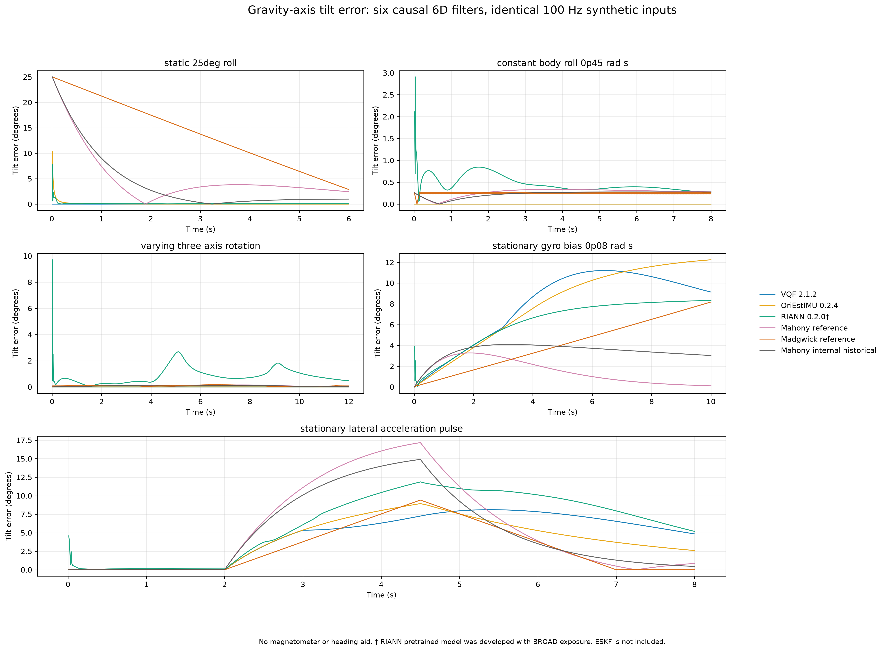
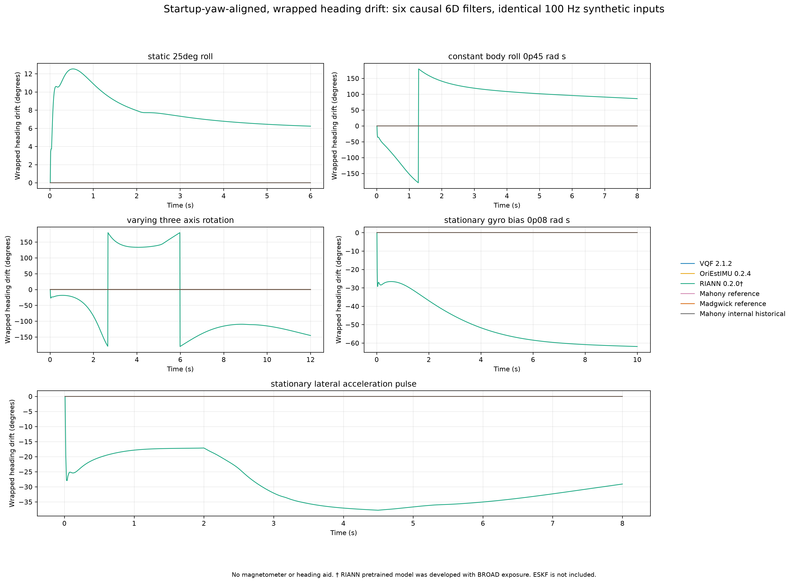
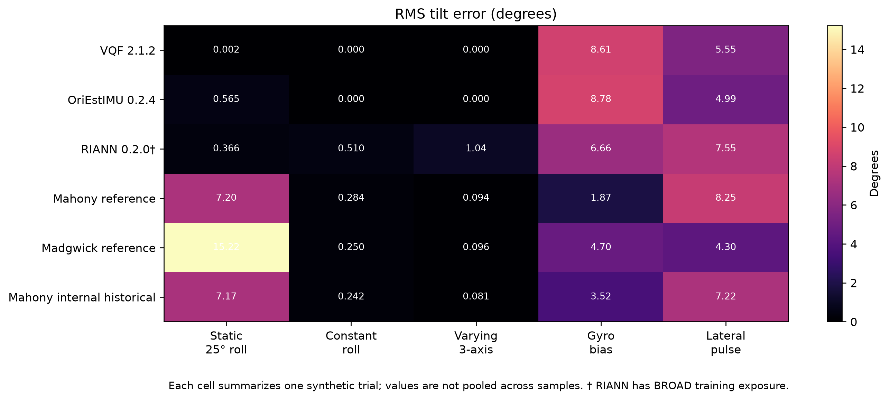
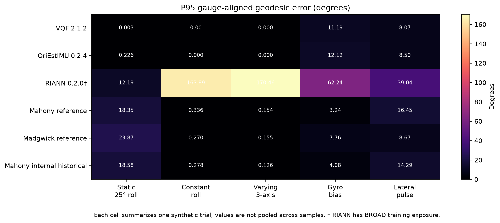

# Synthetic algorithm head-to-head

Six causal 6D adapters processed five deterministic 100 Hz streams (4,400 samples per adapter). The same serialized input was replayed for each algorithm; each trial's input SHA-256 and sample count were checked before scoring.

## Trial-level RMS gravity tilt error (degrees)

| Trial | Samples | VQF 2.1.2 | OriEstIMU 0.2.4 | RIANN 0.2.0† | Mahony reference | Madgwick reference | Mahony internal historical |
|---|---:|---:|---:|---:|---:|---:|---:|
| `static_25deg_roll` | 600 | 0.002 | 0.565 | 0.366 | 7.200 | 15.225 | 7.169 |
| `constant_body_roll_0p45_rad_s` | 800 | 0.000 | 0.000 | 0.510 | 0.284 | 0.250 | 0.242 |
| `varying_three_axis_rotation` | 1200 | 0.000 | 0.000 | 1.044 | 0.094 | 0.096 | 0.081 |
| `stationary_gyro_bias_0p08_rad_s` | 1000 | 8.615 | 8.785 | 6.658 | 1.872 | 4.704 | 3.519 |
| `stationary_lateral_acceleration_pulse` | 800 | 5.548 | 4.992 | 7.552 | 8.252 | 4.304 | 7.218 |

These deterministic fixtures are development evidence. Per-sample outputs are correlated, so the table reports each trial separately without pooled confidence intervals.

## Figures









## Interpretation and limits

- Tilt error is gravity-axis angular error. Geodesic error aligns each estimate's startup heading to the analytic truth at sample 0. Relative heading drift is startup-aligned and wrapped; absolute yaw is unobservable without an independent heading source.
- RIANN is labeled `BROAD_USED_IN_DEVELOPMENT`; this run does not estimate its unseen-data generalization.
- The historical internal Mahony implementation is labeled separately from canonical Mahony. VQF, OriEstIMU, RIANN, and canonical references use their pinned fixed configurations. No sealed trials were used for tuning.
- The production RP2350 ESKF is not included: there is no registered firmware-independent ESKF adapter in the shared API, and the native PR3 C++ runner could not be built because a C++ compiler is unavailable.
- No BROAD dataset score, sensor validation, hardware result, RP2350 resource or timing claim is made. Runtime comparisons are omitted because the algorithms ran in separate pinned dependency environments.

## Reproduction

Run the orchestrator from the qmt 0.2.4 environment (which includes Matplotlib), supplying the pinned VQF and RIANN Python environments:

```powershell
$pythonQmt = '<qmt-env>\Scripts\python.exe'
$pythonVqf = '<vqf-env>\Scripts\python.exe'
$pythonRiann = '<riann-env>\Scripts\python.exe'
& $pythonQmt scripts/run_algorithms_head_to_head.py --runtime-python $pythonQmt --vqf-python $pythonVqf --riann-python $pythonRiann
```

The output JSON contains each versioned adapter identity, fixed config hash, runtime package versions, input hash, and per-trial metrics. The CSV contains one row per trial and adapter. The figures show per-sample traces generated during the run; rerun the command to reproduce the plotted series.
