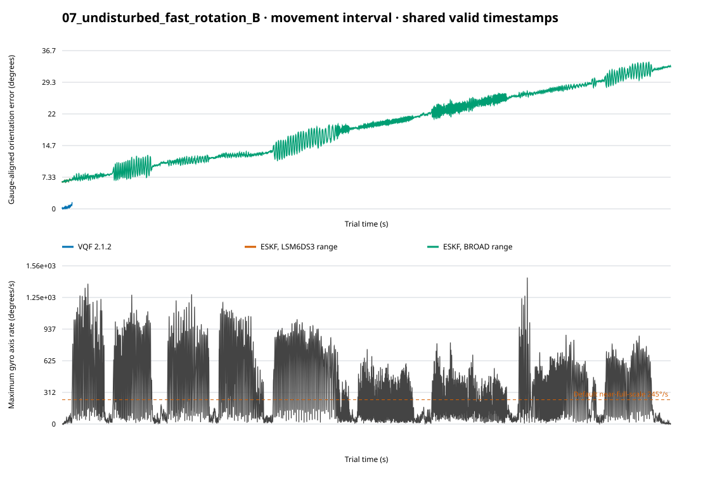
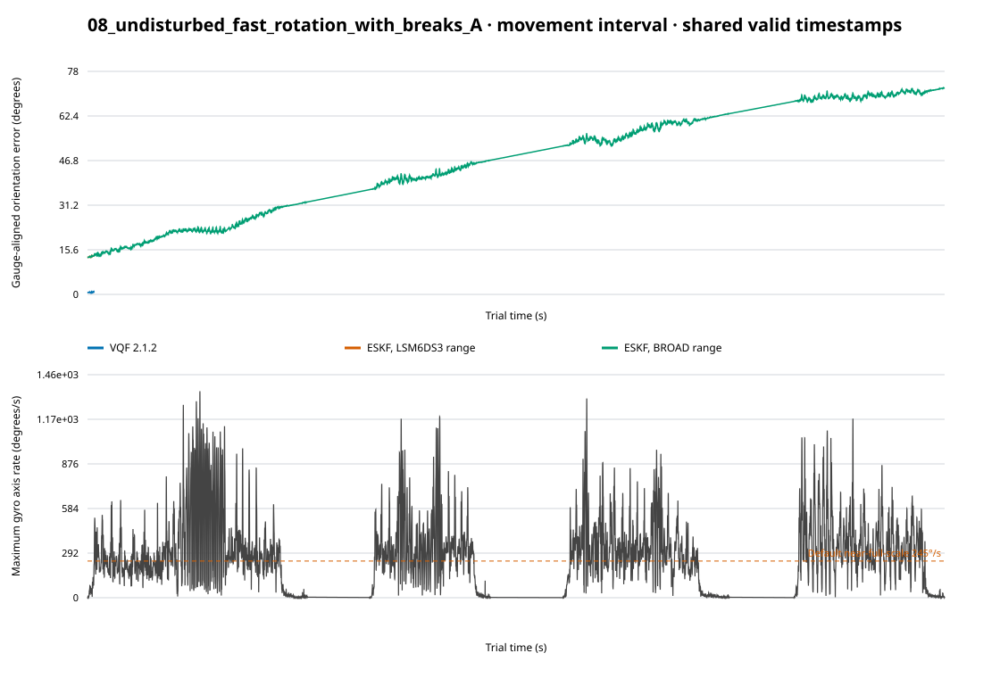
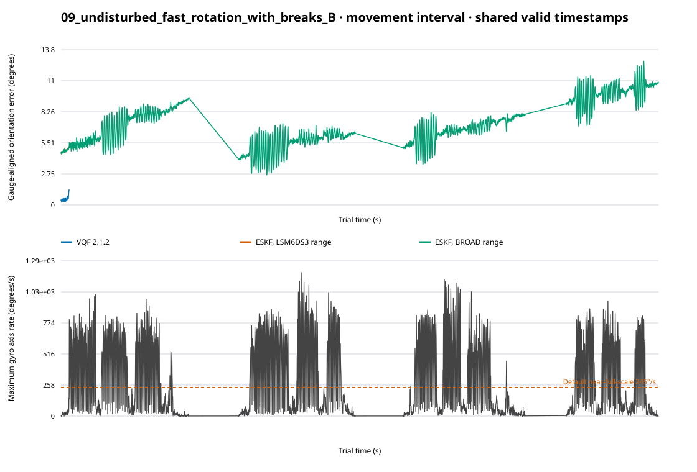

# B9 — Matched-interval BROAD failure atlas

Run date: 2026-11-17 · dataset revision: `7e2f8189bb4a3ac91eae32c69b6bc87f08a6e2ad` · trials: 39

BROAD data by Laidig et al.; source [repository](https://github.com/dlaidig/broad) and [paper](https://doi.org/10.3390/data6070072). The dataset is CC BY 4.0. Files are read from the user-supplied directory and are not copied into this repository.

## Method

Both estimators process all ordered gyro/accelerometer samples at 2000/7 Hz (3500 µs timestamps); no magnetometer is supplied. The output comparison uses the exact VQF/ESKF timestamp intersection. Scores include only movement samples, while filters run through the leading and trailing rest. Each six-axis estimate's startup heading gauge is aligned at the first common valid sample; total geodesic error, gravity tilt, and relative heading drift are reported.

- VQF: official causal 6D adapter vqf_full_6d_causal_v2.1.2 (86ba56bdd3158b9b05f9f9fe5596866ba326438c); config SHA-256 `43d1c50b1726f988bd29894f4637c56d47736c90c7cbafbc4ed114adf03aae0b`.
- ESKF: production `eskf15.hpp`; replay source SHA-256 `cf8d6093ac232f781a543482d26bad07349bbe70d779ccc3e1e59d540af676f0`; input-rate period 3500 µs.
- ESKF defaults: per-axis limits 240.1°/s and 38.44 m/s². BROAD replay: 1960°/s and 153.77 m/s², derived from BROAD's documented sensor settings.
- Scores are not pooled across trials; each paired score requires valid VQF, ESKF, and optical-reference output at the same input timestamp. Scores use only movement samples; the optical reference can be unavailable on some source samples.

## Range fault result

The production LSM6DS3 range profile faulted on 33/39 trials (accel_range: 2, gyro_range: 31). BROAD's documented input range reduced this to 3/39 trials (accel_range: 3). This is a range-configuration effect; production LSM6DS3 defaults were not changed.

The selected fast-rotation trace `07_undisturbed_fast_rotation_B` crosses the default 240.1°/s axis threshold at 28.434 s with 261.2°/s on one gyro axis. The filter latches, leaves `state_timestamp_us` at the prior 28.4305 s state, and marks output invalid; later plotted default-range samples are not extended with that stale orientation.

## Trial results

| Trial | Max gyro axis (°/s) | Default ESKF fault | Matched samples, BROAD range | VQF RMS (°) | ESKF RMS (°) |
|---|---:|---|---:|---:|---:|
| `01_undisturbed_slow_rotation_A` | 320.0 | 67.36s gyro_range | 56699 | 7.885 | 30.297 |
| `02_undisturbed_slow_rotation_B` | 411.5 | 80.49s gyro_range | 51534 | 1.007 | 8.708 |
| `03_undisturbed_slow_rotation_C` | 324.9 | 56.05s gyro_range | 54326 | 2.805 | 8.955 |
| `04_undisturbed_slow_rotation_with_breaks_A` | 457.4 | 32.58s gyro_range | 60569 | 6.674 | 39.675 |
| `05_undisturbed_slow_rotation_with_breaks_B` | 325.9 | 38.74s gyro_range | 57203 | 1.077 | 29.389 |
| `06_undisturbed_fast_rotation_A` | 925.0 | 40.37s gyro_range | 55995 | 1.387 | 44.406 |
| `07_undisturbed_fast_rotation_B` | 1445.7 | 28.43s gyro_range | 50924 | 2.055 | 20.760 |
| `08_undisturbed_fast_rotation_with_breaks_A` | 1352.2 | 29.63s gyro_range | 55025 | 19.691 | 49.592 |
| `09_undisturbed_fast_rotation_with_breaks_B` | 1194.3 | 31.97s gyro_range | 53010 | 1.460 | 7.389 |
| `10_undisturbed_slow_translation_A` | 194.8 | none | 55288 | 2.167 | 4.099 |
| `11_undisturbed_slow_translation_B` | 106.1 | none | 51538 | 1.010 | 18.040 |
| `12_undisturbed_slow_translation_C` | 177.6 | none | 53826 | 2.867 | 24.438 |
| `13_undisturbed_slow_translation_with_breaks_A` | 85.8 | none | 70602 | 4.056 | 56.682 |
| `14_undisturbed_slow_translation_with_breaks_B` | 95.0 | none | 51535 | 1.063 | 20.480 |
| `15_undisturbed_fast_translation_A` | 426.2 | 64.49s gyro_range | 52391 | 3.287 | 50.649 |
| `16_undisturbed_fast_translation_B` | 586.0 | 37.70s gyro_range | 50124 | 0.793 | 26.379 |
| `17_undisturbed_fast_translation_with_breaks_A` | 470.1 | 33.39s gyro_range | 60149 | 3.967 | 35.913 |
| `18_undisturbed_fast_translation_with_breaks_B` | 721.3 | 33.86s gyro_range | 51480 | 1.030 | 15.940 |
| `19_undisturbed_slow_combined_240s` | 349.8 | 134.88s gyro_range | 85552 | 4.620 | 10.211 |
| `20_undisturbed_slow_combined_360s` | 308.2 | 57.07s gyro_range | 120090 | 9.924 | 18.882 |
| `21_undisturbed_fast_combined` | 727.9 | 37.71s gyro_range | 51386 | 10.187 | 13.929 |
| `22_undisturbed_fast_combined_240s` | 543.7 | 33.90s gyro_range | 85789 | 24.210 | 28.833 |
| `23_undisturbed_fast_combined_360s` | 688.0 | 42.62s gyro_range | 120054 | 36.715 | 38.435 |
| `24_disturbed_tapping_A` | 519.1 | 46.91s gyro_range | 30118 | 1.054 | 14.459 |
| `25_disturbed_tapping_B` | 310.6 | 53.21s accel_range | 30315 | 2.012 | 18.805 |
| `26_disturbed_phone_vibration_A` | 500.7 | 48.93s gyro_range | 53197 | 1.792 | 7.586 |
| `27_disturbed_phone_vibration_B` | 124.3 | none | 51769 | 3.199 | 28.741 |
| `28_disturbed_stationary_magnet_A` | 752.4 | 43.17s gyro_range | 51184 | 6.390 | 7.858 |
| `29_disturbed_stationary_magnet_B` | 858.5 | 33.75s gyro_range | 50970 | 10.980 | 4.215 |
| `30_disturbed_stationary_magnet_C` | 814.4 | 31.97s gyro_range | 48712 | 10.919 | 11.786 |
| `31_disturbed_stationary_magnet_D` | 774.3 | 32.62s gyro_range | 48582 | 6.253 | 7.171 |
| `32_disturbed_attached_magnet_1cm` | 360.2 | 42.91s gyro_range | 45436 | 4.375 | 14.116 |
| `33_disturbed_attached_magnet_2cm` | 350.8 | 47.67s gyro_range | 44097 | 4.999 | 8.663 |
| `34_disturbed_attached_magnet_3cm` | 333.1 | 49.79s gyro_range | 44798 | 7.111 | 13.433 |
| `35_disturbed_attached_magnet_4cm` | 334.7 | 49.31s gyro_range | 42964 | 6.062 | 12.911 |
| `36_disturbed_attached_magnet_5cm` | 430.7 | 45.08s gyro_range | 42877 | 9.054 | 17.152 |
| `37_disturbed_office_A` | 389.5 | 61.79s gyro_range | 60096 | 9.654 | 30.997 |
| `38_disturbed_office_B` | 423.1 | 54.10s gyro_range | 77157 | 8.691 | 35.076 |
| `39_disturbed_mixed` | 1659.4 | 37.19s accel_range | 52192 | 1.026 | 9.093 |

## Selected high-rate traces

All 39 per-trial figures show orientation error only at shared valid movement timestamps; their lower panels show maximum absolute gyro-axis rate and both near-full-scale thresholds. Detailed CSV traces are saved for the three selected high-rate trials. An ESKF error line stops at a range fault and is not extended with its last quaternion.

## Evidence files

- `b9_broad_summary.csv`: one movement-only summary row per trial.
- `b9_broad_results.json`: method, configuration, source, per-trial validity, fault, and paired metric records.
- `traces/*.csv.gz`: selected high-rate per-sample errors and ESKF diagnostics.
- `figures/gyro_range_fault_atlas.svg`: all-trial gyro range exposure and default-range fault markers.
- `figures/orientation_error_*.svg`: all 39 shared-time orientation-error timelines.

No parameter search or claim of LSM6DS3 hardware performance is made. The BROAD full-scale replay is a dataset-specific configuration experiment; it does not change production defaults.
