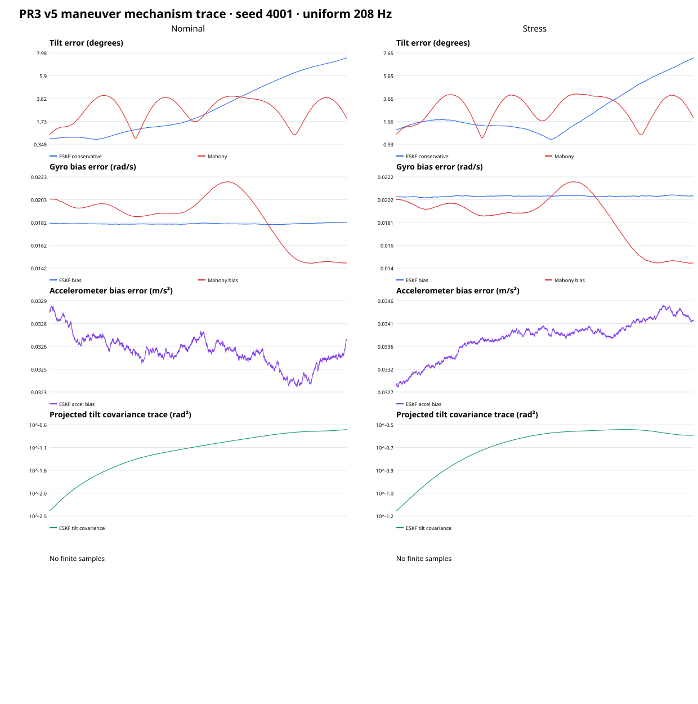
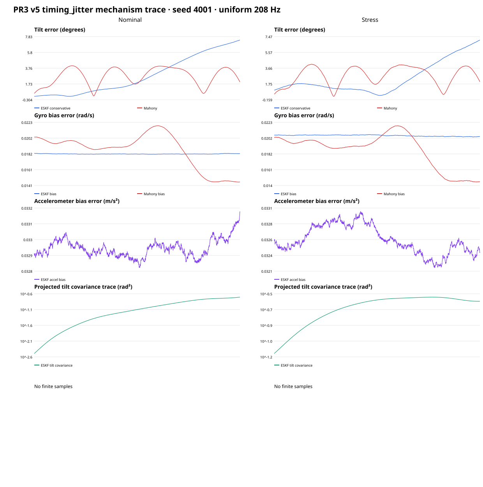
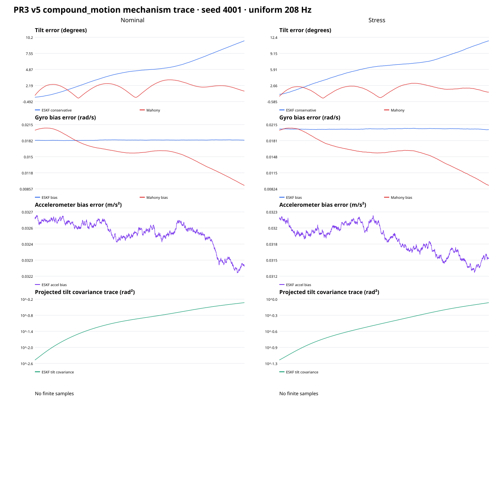
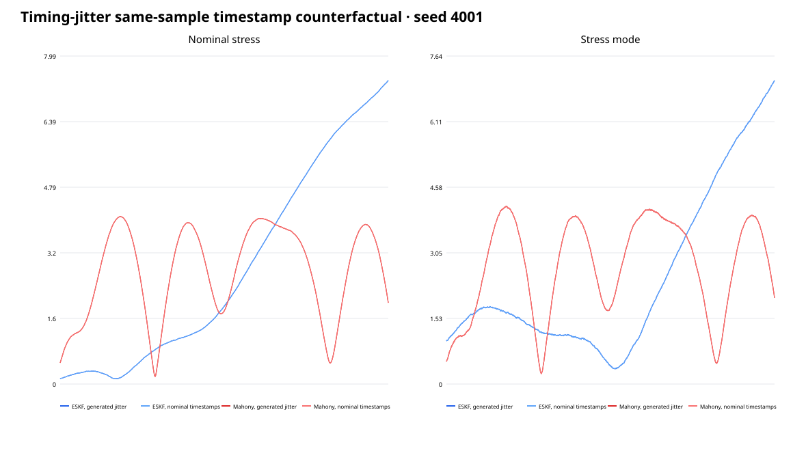

# PR3 synthetic weakness traces (B9)

Run date: 2026-11-17 · seed: 4001 · split: development · rate: uniform_208hz

The six selected raw input streams are regenerated with the frozen PR3 v5 generator. Every input SHA-256 and all five evaluator summary rows per stream are checked against the frozen archive before any joined trace is written. Metrics are the archived fixed evaluation window (nominal sample indices 2–16 s); traces retain the complete 16 s stream.

Protocol SHA-256: `1318acff98ac2641383ef6a568986e912020a6d4c6debeb145a9abf0f8fa4800` · archive SHA-256: `ad73e542d57d43fc4a707a82b9011dfc5ece30a44313574b49dbea14eeaee755` · replay evaluator source SHA-256: `2d2c2bd9e7dec4e627b166cd6be7d9d9a58081edaf053b707b498999a95ad680` · archive evaluator source SHA-256: `e44fa1eae87e377d7fa4edf47a11a4d28f7d8e9dfd3312ffbb7dc427aee22c3e`.

## Paired results

| Scenario | Mode | ESKF tilt RMS (°) | Mahony tilt RMS (°) | ESKF − Mahony (°) | Gravity accepted / attempted | Gate reasons (initialized samples) |
|---|---|---:|---:|---:|---:|---|
| `maneuver` | nominal | 3.872 | 2.967 | +0.904 | 14 / 14 | accepted: 14, aid_cadence_pending: 287, candidate_dwell_incomplete: 34, candidate_gate_failed: 2913, initialization_complete: 1 |
| `maneuver` | stress | 3.199 | 2.973 | +0.226 | 0 / 0 | candidate_dwell_incomplete: 278, candidate_gate_failed: 2970, initialization_complete: 1 |
| `timing_jitter` | nominal | 3.725 | 2.962 | +0.763 | 14 / 14 | accepted: 14, aid_cadence_pending: 287, candidate_dwell_incomplete: 34, candidate_gate_failed: 2913, initialization_complete: 1 |
| `timing_jitter` | stress | 3.131 | 2.972 | +0.159 | 0 / 0 | candidate_dwell_incomplete: 268, candidate_gate_failed: 2980, initialization_complete: 1 |
| `compound_motion` | nominal | 5.226 | 2.032 | +3.194 | 14 / 14 | accepted: 14, aid_cadence_pending: 287, candidate_dwell_incomplete: 34, candidate_gate_failed: 2913, initialization_complete: 1 |
| `compound_motion` | stress | 6.871 | 2.029 | +4.841 | 0 / 0 | candidate_dwell_incomplete: 260, candidate_gate_failed: 2988, initialization_complete: 1 |

## Diagnostic timelines

### maneuver

### timing_jitter

### compound_motion

### Timing-jitter isolation

The nominal-grid counterfactual preserves the timing-jitter trial's exact gyro, accelerometer, truth, and noise samples, changing only `reported_timestamp_us` to the nominal grid. It is a mechanism check and does not carry frozen-archive status; the original timing-jitter traces above are archive matched.

| Mode | Archived ESKF RMS (°) | Same-sample no-jitter ESKF RMS (°) | ESKF change (°) | Archived Mahony RMS (°) | Same-sample no-jitter Mahony RMS (°) |
|---|---:|---:|---:|---:|---:|
| nominal | 3.725 | 3.725 | +0.0004 | 2.962 | 2.962 |
| stress | 3.131 | 3.132 | +0.0008 | 2.972 | 2.972 |

## Mechanism findings

- **Maneuver:** ESKF trails Mahony by 0.904° RMS. The evaluation window has 2913 candidate-gate failures and 0 gravity attempts; all 14 attempts were accepted during startup. The max attempted NIS is 0.0214, so this trace does not point to NIS rejection. ESKF gyro-bias error ends at 0.0182 rad/s versus Mahony at 0.0146 rad/s.
- **Timing jitter:** ESKF trails Mahony by 0.763° RMS with reported offsets -150 to 150 µs. Replacing only the reported timestamps with the nominal grid changes ESKF RMS by +0.0004° in nominal and +0.0008° in stress. For this seed, timestamp jitter does not explain the ESKF/Mahony gap; the same gravity-gate and bias pattern remains.
- **Compound motion:** ESKF trails Mahony by 3.194° nominal and 4.841° under stress. The projected tilt-covariance trace grows to 0.476 and 0.871 rad² while staying positive definite. Stress has 557 acceleration-step gate failures and no evaluation-window gravity attempts.
- **Shared pattern:** motion-rate/stationarity checks prevent ESKF gravity updates before innovation formation; blank NIS values mark those pre-measurement rejections. Mahony continues accelerometer feedback and integral gyro-bias adaptation during motion, which wins on these selected synthetic streams. The results show a conservative-gating tradeoff, not a covariance numeric failure. They do not establish that Mahony is safer under unmodeled accelerations.

## Reading the diagnostics

Gravity NIS and innovation are recorded only when the filter reaches a gravity measurement attempt. A blank NIS means an earlier candidate/stationarity gate prevented a measurement from being formed; it is not a zero innovation. Covariance trace is the evaluator's projected two-dimensional tilt covariance. Bias-error traces compare state estimates with the shared simulator truth. Mahony has no accelerometer-bias state.

The checked-in archive was produced with a different evaluator source revision. Before the joined traces were written, all five estimator summary rows for all six selected raw inputs were replayed with the evaluator recorded above and every archived metric field was checked against the frozen archive. The generator, protocol, filter header, input hashes, and those replayed metrics matched. These are selected development traces, not new acceptance statistics or a parameter search.
